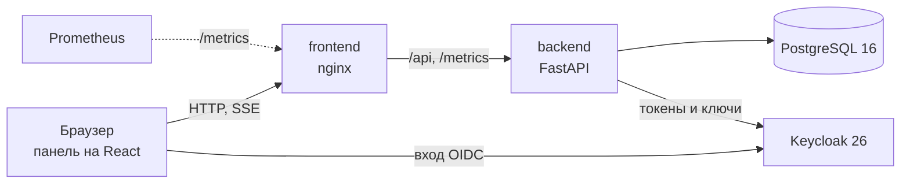
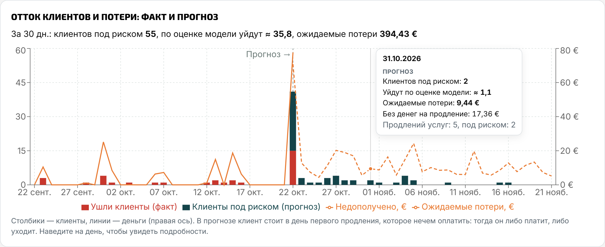

# SaveFlow — анализатор рисков оттока

Веб-панель для маркетологов хостинга. Она отвечает на три вопроса: **кому из клиентов нужно внимание**, **почему возник риск** и **сколько денег бизнес может потерять**. Результат — приоритетный список: кому звонить первым и сколько это сохранит.

Решение кейса Aéza «Анализатор рисков оттока» — хакатон РНД, уровень Middle. Команда «Точно Профессионалы».

## Содержание

- [Возможности](#возможности)
- [Запуск через Docker](#запуск-через-docker)
- [Как пользоваться](#как-пользоваться)
- [Архитектура](#архитектура)
- [Модель риска оттока](#модель-риска-оттока)
- [Денежная оценка](#денежная-оценка)
- [График оттока](#график-оттока)
- [Как добавить новый признак](#как-добавить-новый-признак)
- [API](#api)
- [Метрики Prometheus](#метрики-prometheus)
- [Вход через OIDC (SSO)](#вход-через-oidc-sso)
- [Разработка без Docker](#разработка-без-docker)
- [Структура репозитория](#структура-репозитория)
- [Ветки и команда](#ветки-и-команда)

## Возможности

| Требование ТЗ | Как сделано |
|---|---|
| Веб-панель | У каждого клиента score 0–100, уровень риска (высокий, средний, низкий) и причины простыми словами. Нет данных — явно «Нет оценки» с объяснением. Лояльность = 100 − score |
| Топ клиентов под риском | Таблица: ID, email, баланс, сумма пополнений, risk-score и главная причина. Сортировка по каждому полю в обе стороны, фильтр по уровню, поиск по email или ID |
| Настройка модели | Веса признаков и пороги уровней — ползунками на странице «Модель и данные». Хранятся в PostgreSQL и переживают перезапуск. Сброс к значениям по умолчанию с отменой |
| Денежная оценка | Ожидаемые потери за 30 дней с учётом цен услуг, балансов и бонусов клиентов и риска, плюс объяснение, как получилась сумма |
| Живое обновление | После загрузки данных или изменения коэффициентов оценки пересчитываются, а панель обновляется сама (SSE), без перезагрузки страницы |
| `/metrics` | Клиенты по уровням риска, деньги и служебные показатели в формате Prometheus |
| Расширяемость | Новый признак — одна функция с декоратором `@feature`, без миграций |
| Docker | `docker compose up --build` поднимает базу, бэкенд, панель и Keycloak |
| Аутентификация | Логин и пароль; без входа API отвечает 401. Сессии в PostgreSQL |
| **Дополнительно:** OIDC | Вход через Keycloak (Authorization Code + PKCE), запасной вход по паролю |
| **Дополнительно:** график оттока | Факт (ушедшие клиенты, недополученная выручка) и прогноз на 30 дней (клиенты под риском, ожидаемые потери) различимы |
| **Дополнительно:** UX/UI | Фирменный стиль, понятная навигация, подсказки у показателей |

## Запуск через Docker

Нужен Docker с Compose v2 (Docker Desktop или `docker compose` на Linux). Из корня репозитория:

```bash
docker compose up --build
```

Первая сборка занимает несколько минут. Когда в логе появится `Uvicorn running`, откройте:

| Что | Адрес |
|---|---|
| Панель | http://localhost:8080 — вход `admin` / `admin` или «Войти через Keycloak»: `analyst` / `analyst` |
| Keycloak (провайдер входа OIDC) | http://localhost:8180 — администратор `admin` / `admin` |
| Swagger | http://localhost:8080/api/v1/docs |
| OpenAPI | http://localhost:8080/api/v1/openapi.json (копия в [docs/openapi.json](docs/openapi.json)) |
| Метрики Prometheus | http://localhost:8080/metrics — без авторизации |
| Healthcheck | http://localhost:8080/healthz |

Что поднимается: `db` (PostgreSQL 16), `backend` (FastAPI), `frontend` (nginx: панель, прокси на `/api`, `/metrics`, `/healthz`) и `keycloak` (провайдер входа OIDC). Наружу открыты порт панели и порт Keycloak. При старте бэкенд накатывает миграции и, если база пустая, загружает тестовый набор `data/data.json`.

Данные, настройки модели и сессии входа хранятся в томе `pgdata` и переживают перезапуск:

```bash
docker compose down      # остановить, данные сохранятся
docker compose down -v   # остановить и удалить данные: следующий запуск начнётся с data/data.json
```

**Настройки.** Скопируйте `.env.example` в `.env` рядом с `docker-compose.yml` и раскомментируйте нужное:

| Переменная | По умолчанию | Что делает |
|---|---|---|
| `PUBLIC_HOST` | `localhost` | адрес, по которому панель открывают в браузере: IP или домен сервера. Нужен для входа через Keycloak не на своём компьютере |
| `APP_PORT` | `8080` | порт панели на хосте |
| `DEMO_USER`, `DEMO_PASSWORD` | `admin`, `admin` | логин и пароль входа — поменяйте перед показом |
| `DB_PASSWORD` | `churn` | пароль PostgreSQL, только буквы и цифры |
| `SEED_ON_START` | `1` | `0` — не загружать `data/data.json` в пустую базу |
| `SESSION_TTL_HOURS` | `12` | сколько часов действует вход |
| `KEYCLOAK_PORT` | `8180` | порт Keycloak на хосте |
| `KEYCLOAK_ADMIN_PASSWORD` | `admin` | пароль администратора Keycloak |

Если порт 8080 занят: `APP_PORT=8090 docker compose up --build` (в PowerShell — строка `APP_PORT=8090` в `.env`).

**На сервере.** Если панель открывают не на том компьютере, где запущен Docker, укажите в `.env` его адрес — например `PUBLIC_HOST=203.0.113.10` или `PUBLIC_HOST=saveflow.example.com` — и выполните `docker compose up -d --build`. Без этого кнопка «Войти через Keycloak» уводит браузер на `localhost`, то есть на компьютер самого пользователя. На сервере должны быть открыты оба порта: `APP_PORT` (панель) и `KEYCLOAK_PORT` (страница входа Keycloak). Keycloak при смене адреса пересоздаётся и заново импортирует realm, в котором этот адрес разрешён для возврата в панель.

## Как пользоваться

1. **Найти клиента под риском.** «Клиенты» → сортировка по risk-score или фильтр «Высокий риск». Главная причина видна прямо в строке.
2. **Объяснить оценку.** Карточка клиента показывает вклад каждого признака в баллах, к какой услуге он относится, балансы и ожидаемые потери.
3. **Изменить коэффициент или данные.** «Модель и данные» → подвиньте ползунок или загрузите новый снимок JSON.
4. **Увидеть результат.** «Обзор», рейтинг и деньги обновятся сами, без перезагрузки страницы.


**Данные.** Снимок в формате [data/data.json](data/data.json) загружается на странице «Модель и данные» или запросом `PUT /api/v1/source/snapshot`. Он полностью заменяет данные, а оценки пересчитываются сразу. «Сейчас» для модели — дата снимка (`referenceDate`), поэтому результат зависит только от данных. Готовые наборы:

| Файл | Что внутри |
|---|---|
| `data/data.json` | тестовый набор из ТЗ: 10 клиентов, 30 услуг; загружается в пустую базу при старте |
| `demo/demo_day0.json`, затем `demo/demo_day3.json` | 200 клиентов, два снимка с разницей в три дня: между ними меняются статусы услуг, на графике появляется факт оттока |
| `demo/demo_100.json` | 100 клиентов с перемешанными ситуациями; кто есть кто — в [demo/demo_100.md](demo/demo_100.md) |
| `demo/presentation_day1.json`, затем `demo/presentation_day2.json` | 18 клиентов для доклада, по каждому аспекту модели |

## Архитектура



- **frontend** — nginx отдаёт собранную панель (React + TypeScript) и проксирует `/api`, `/metrics`, `/healthz` на бэкенд.
- **backend** — FastAPI: REST API, модель риска (`app/risk`), события SSE, метрики. Миграции Alembic накатываются при старте.
- **PostgreSQL** — исходные данные (аккаунты, услуги, транзакции), история статусов услуг, результаты расчёта, настройки модели и сессии входа.
- **Keycloak** — провайдер входа OIDC с готовым realm `saveflow`.

**Как идёт пересчёт.** Загрузка снимка (`PUT /source/snapshot`) или изменение настроек (`PATCH /model/settings`) пересчитывает все оценки в одной транзакции. Каждый расчёт записывается как запуск (`risk_runs`), чтобы было видно, на каких настройках он сделан. Панель подписана на SSE `/api/v1/events/stream`: после пересчёта приходит событие, и открытые страницы перезапрашивают данные. Дополнительно они опрашивают API раз в 5 секунд и при возвращении на вкладку.

**Стек**

| Часть | Технологии |
|---|---|
| Бэкенд | Python 3.12, FastAPI, Uvicorn, SQLAlchemy 2, Alembic, Pydantic 2, PyJWT |
| Фронтенд | React 18, TypeScript, Vite 5, Recharts, React Router, Axios |
| Инфраструктура | Docker Compose, PostgreSQL 16, nginx, Keycloak 26, метрики Prometheus |
| Качество | pytest (≈ 470 тестов), тесты фронтенда на `node:test`, OpenAPI + Swagger |

## Модель риска оттока

Модель — прозрачная скоринговая карта: каждый балл в оценке объясняется конкретной причиной.

1. **Что оценивается.** Действующие услуги клиента: `active`, `suspended`, `prolong_wait`. Услуги `deleted` и `blocked` уже потеряны: они не получают оценку, но учитываются в истории клиента и на графике оттока. Нет действующих услуг — вместо score «Нет оценки» с причиной.
2. **Score услуги** = сумма вкладов признаков, не больше 100. Вклад = вес × значение признака от 0 до 1. Веса меняются в панели и хранятся в Postgres, поэтому переживают перезапуск.
3. **Score клиента** — максимальный score среди его услуг. Уровень: от 60 — высокий, от 30 — средний, ниже — низкий (пороги тоже в настройках). Лояльность = 100 − score.
4. **Причины** — самые сильные вклады признаков с понятным текстом и услугой, к которой они относятся.

| Признак | Вес | Когда срабатывает |
|---|---|---|
| Ожидает оплаты | 45 | услуга в `prolong_wait`: срок истёк, через 5 дней её удалят |
| Не хватает средств | 35 | денег (баланс + доступные бонусы) не хватит на продления в ближайшие 30 дней; чем раньше кончатся, тем сильнее |
| Истекает без автопродления | 30 | автопродление выключено, а срок истекает в ближайшие 30 дней; чем ближе, тем сильнее |
| Уже уходил | 15 | доля удалённых или заблокированных услуг клиента |
| Сервер выключен | 10 | `suspended`: клиент платит, но не пользуется |
| Неоплаченные платежи | 10 | доля непроведённых (`not_performed`) транзакций по услуге |
| Новая услуга | 5 | подключена меньше 30 дней назад |


## Денежная оценка

Сколько бизнес может потерять за ближайшие 30 дней. Суммы в данных — в евроцентах.

```
продления за 30 дней   = цена периода (price) × сколько раз услугу нужно оплатить
спишется с баланса     = продления, которые автопродление оплатит с основного баланса
оплатят бонусы         = продления, которые автопродление затем оплатит доступными бонусами
под угрозой            = продления − спишется с баланса − оплатят бонусы
ожидаемая потеря       = Σ по услугам: score услуги / 100 × её сумма под угрозой   ← главная цифра панели
```

Вероятность берётся у каждой услуги своя: у клиента с сотней услуг одна горящая услуга не умножает свою вероятность на продления остальных. Признаки клиента — нехватка денег, история уходов — входят в score каждой его услуги. Уровень риска клиента по-прежнему определяет его худшая услуга: она показывает, кому звонить первым.

Автопродление оплачивает продления по порядку их наступления, сначала с баланса, потом бонусами; продление нельзя оплатить частично. Продления, наступившие в один и тот же момент, оплачиваются по очереди, пока на очередное хватает денег. Услуга в `prolong_wait` под угрозой целиком: её автосписание уже не прошло.

Пример: у клиента две услуги. Первая — score 70, продлений на 20 €, с баланса спишется 5 €, бонусами — 3 €, под угрозой 12 €. Вторая — score 10, под угрозой 30 €. Ожидаемая потеря 0,70 × 12 € + 0,10 × 30 € = 8,40 € + 3,00 € = 11,40 €.

Формула учитывает все три фактора из ТЗ: **стоимость услуг** — через продления, **балансы** — дважды (нехватка денег повышает риск, а то, что спишется с баланса и бонусов, не под угрозой), **риск** — через score каждой услуги. Тот же расчёт и его словесное объяснение отдаёт `GET /api/v1/analytics/summary`, а `/metrics` — те же числа для Prometheus.

## График оттока



- **Факт** — слева от пунктира: сколько клиентов потеряли услуги и сколько выручки не пришло по дням. История копится из снимков: каждая загрузка записывает переходы статусов услуг. Удалённые услуги без истории показаны с оценённой датой (`expiresAt` + 5 дней).
- **Прогноз** — на 30 дней вперёд: клиенты под риском и ожидаемые потери по дням. Клиент стоит в день первого продления, которое нечем оплатить: тогда он либо платит, либо уходит. Сумма потерь по дням совпадает с «Ожидаемыми потерями» на обзоре.

Данные графика — `GET /api/v1/analytics/churn-timeline`. Подробнее о модели, деньгах, опорной дате и графике — в [docs/MODEL.md](docs/MODEL.md).

## Как добавить новый признак

Достаточно одной функции в `app/risk/features.py` — миграции и правки в других файлах не нужны:

```python
# app/risk/features.py; в импорты файла добавить: from app.risk.terms import monthly_price
@feature("low_replenishment", title="Мало пополняет", default_weight=10,
         description="За всё время пополнил меньше, чем стоит его услуга за год.")
def low_replenishment(ctx: ServiceContext) -> FeatureResult:
    yearly = monthly_price(ctx.service.price, ctx.service.payment_term) * 12
    if yearly == 0 or ctx.account.total_replenished >= yearly:
        return NO_SIGNAL
    return FeatureResult(1 - ctx.account.total_replenished / yearly,
                         f"Пополнил {eur(ctx.account.total_replenished)} — меньше годовой стоимости услуги")
```

После перезапуска признак сам появится в `GET /api/v1/model/settings` и на странице настроек со своим весом, его вклад и текст причины — в оценках клиентов. Веса новых признаков берутся по умолчанию, пока их не изменят в панели.

## API

Все эндпоинты, кроме входа, `/metrics`, `/healthz` и документации, требуют заголовок `Authorization: Bearer <токен>`. Токен выдаёт `POST /api/v1/auth/login`. Полная документация — Swagger на `/api/v1/docs`, спецификация — [docs/openapi.json](docs/openapi.json), примеры ответов — [docs/examples](docs/examples).

| Метод | Эндпоинт | Назначение |
|---|---|---|
| POST | `/api/v1/auth/login` | вход по логину и паролю |
| GET | `/api/v1/auth/me` | текущий пользователь |
| POST | `/api/v1/auth/logout` | завершение сессии |
| GET | `/api/v1/customers` | клиенты с оценками: фильтр по уровню, поиск, сортировка, страницы |
| GET | `/api/v1/customers/{id}` | подробная оценка клиента: услуги, признаки, причины, деньги |
| GET | `/api/v1/analytics/summary` | сводка риска и денежной оценки с объяснением |
| GET | `/api/v1/analytics/churn-timeline` | график оттока: факт и прогноз по дням |
| GET | `/api/v1/model/settings` | веса, пороги, значения по умолчанию |
| PATCH | `/api/v1/model/settings` | изменение настроек с пересчётом |
| PUT | `/api/v1/source/snapshot` | загрузка или полная замена снимка данных с пересчётом |
| GET | `/api/v1/events/stream` | SSE: событие после каждого пересчёта |
| GET | `/metrics` | метрики Prometheus |
| GET | `/api/v1/docs` | Swagger |

Вход через OIDC — `/api/v1/auth/oidc/*`, описан [ниже](#вход-через-oidc-sso).

```bash
TOKEN=$(curl -s -X POST http://localhost:8080/api/v1/auth/login \
  -H 'Content-Type: application/json' -d '{"username":"admin","password":"admin"}' | jq -r .access_token)
curl -s http://localhost:8080/api/v1/customers?level=high -H "Authorization: Bearer $TOKEN"
```

## Метрики Prometheus

`GET /metrics` без авторизации отдаёт те же числа, что панель:

| Метрика | Что это |
|---|---|
| `churn_customers{level="high\|medium\|low\|none"}` | клиенты по уровням риска |
| `churn_average_score` | средний score клиентов с оценкой |
| `churn_services{state="total\|live\|at_risk"}` | услуги: всего, действующие, под риском |
| `churn_expected_loss_eur{horizon_days="30"}` | ожидаемые потери |
| `churn_revenue_at_risk_eur{horizon_days="30"}` | выручка под угрозой |
| `churn_horizon_revenue_eur`, `churn_covered_by_bonus_eur` | продления за горизонт и то, что оплатят бонусы |
| `churn_monthly_revenue_eur`, `churn_expected_monthly_loss_eur` | выручка и ожидаемые потери в месяц |
| `churn_last_recalculation_timestamp_seconds`, `churn_model_settings_version` | когда был последний пересчёт и на какой версии настроек |

```yaml
scrape_configs:
  - job_name: saveflow
    static_configs:
      - targets: ["localhost:8080"]
```

## Вход через OIDC (SSO)

На странице входа две возможности: кнопка «Войти через Keycloak» и, как запасной вариант, логин и пароль (`DEMO_USER` / `DEMO_PASSWORD`). Обе дают одинаковую сессию: она хранится в Postgres и переживает перезапуск бэкенда.

В Docker Keycloak поднимается сам с готовым realm `saveflow` ([docker/keycloak/saveflow-realm.json](docker/keycloak/saveflow-realm.json)). Первый старт Keycloak занимает около минуты, панель работает и без него.

| Пользователь Keycloak | Пароль | Результат |
|---|---|---|
| `analyst` | `analyst` | входит в панель: у него роль `analyst` |
| `guest` | `guest` | Keycloak пускает, панель — нет: «У пользователя «guest» нет роли «analyst»». Сессия `guest` в Keycloak при этом закрывается, так что можно сразу войти другим пользователем |

Как это работает: Authorization Code + PKCE. Кнопка ведёт на `GET /api/v1/auth/oidc/login`: бэкенд запоминает `state`, `nonce` и `code_verifier` (таблица `oidc_login_requests`, запись одноразовая и живёт 10 минут) и отправляет браузер в Keycloak. После входа Keycloak возвращает браузер на `/api/v1/auth/oidc/callback`. Бэкенд меняет код на `id_token` и проверяет подпись по ключам провайдера, издателя, получателя, срок действия, `nonce` и роль. Затем выдаёт обычную сессию SaveFlow и возвращает на панель; токен передаётся во фрагменте адреса (`#`), поэтому не попадает в логи. «Выйти» завершает сессию и у Keycloak, так что следующий вход снова спросит пароль. `id_token` сессии хранится до выхода (таблица `auth_sessions`), поэтому Keycloak не переспрашивает «Выйти?» и сразу показывает свою форму входа. Страница входа Keycloak оформлена в стиле SaveFlow ([docker/keycloak/themes/saveflow](docker/keycloak/themes/saveflow)).

Подключить другой провайдер (Google, Microsoft Entra, GitLab, Authentik…) можно без правки кода, переменными бэкенда:

| Переменная | Что это |
|---|---|
| `OIDC_ISSUER` | адрес провайдера, как в `iss` токенов. Не задан — вход через OIDC выключен, кнопки нет |
| `OIDC_INTERNAL_ISSUER` | тот же провайдер, но адрес, по которому до него достаёт бэкенд (в Docker — `http://keycloak:8080/...`) |
| `OIDC_CLIENT_ID`, `OIDC_CLIENT_SECRET` | клиент, зарегистрированный у провайдера; секрет — только для конфиденциального клиента |
| `OIDC_REDIRECT_URI` | адрес возврата: `http://<панель>/api/v1/auth/oidc/callback`, его же надо разрешить у провайдера |
| `OIDC_POST_LOGOUT_REDIRECT_URI` | куда провайдер вернёт после отказа в доступе (с текстом ошибки), обычно `http://<панель>/login`. После обычного выхода он возвращает на `/api/v1/auth/oidc/login` рядом с `OIDC_REDIRECT_URI` — снова на форму входа провайдера |
| `OIDC_REQUIRED_ROLE`, `OIDC_ROLES_CLAIM` | роль для доступа к панели и claim, где лежат роли (по умолчанию `roles`; можно путь через точку, например `realm_access.roles`). Роль не задана — пускает любого вошедшего |
| `OIDC_USERNAME_CLAIM` | чьё имя показывать (по умолчанию `preferred_username`, затем `email`, затем `sub`) |
| `OIDC_NAME`, `OIDC_SCOPES` | подпись кнопки и запрашиваемые scope (по умолчанию `openid profile email`) |

## Разработка без Docker

Нужны Python 3.12, Node.js 20 и PostgreSQL 16 (свой или из Docker: `docker run -d -p 5432:5432 -e POSTGRES_USER=churn -e POSTGRES_PASSWORD=churn -e POSTGRES_DB=churn postgres:16-alpine`).

**Бэкенд**

```bash
python -m venv .venv
source .venv/bin/activate          # Windows: .venv\Scripts\activate
pip install -r requirements-dev.txt
cp .env.example .env               # адрес базы — в DATABASE_URL
python -m app.risk.cli load data/data.json
uvicorn main:app --reload --port 8000
```

Миграции накатываются при старте сервера (`AUTO_MIGRATE=0` — выключить). Консольная утилита `python -m app.risk.cli` загружает снимки и показывает расчёт без панели: `summary`, `customers`, `customer ID`, `settings`, `timeline`, `metrics`, `dbcheck`.

**Фронтенд**

```bash
cd front
npm ci
npm run dev                        # http://localhost:5173, /api проксируется на localhost:8000
```

Другой адрес бэкенда — переменная `VITE_BACKEND_URL`. Для входа через Keycloak без Docker запустите Keycloak отдельно, импортируйте тот же realm и задайте в `.env` `OIDC_ISSUER=http://localhost:8180/realms/saveflow` и `OIDC_REDIRECT_URI=http://localhost:5173/api/v1/auth/oidc/callback` (адрес фронта в `npm run dev`).

## Структура репозитория

```
app/
  api/          HTTP-слой: эндпоинты, SSE, /metrics
  core/         аутентификация и вход через OIDC
  db/           модели таблиц, подключение, миграции при старте, сессии входа
  risk/         модель: признаки (features.py), расчёт score и денег (scoring.py), сценарии (service.py)
front/          панель: React + TypeScript (src/pages, src/components, src/api)
migrations/     миграции Alembic
docker/         realm и тема страницы входа Keycloak
data/           тестовый набор из ТЗ и его генератор
demo/           демо-снимки для показа
docs/           описание модели, OpenAPI, примеры ответов, скриншоты
scripts/        пересборка примеров ответов и демо-данных
tests/          тесты бэкенда
main.py         точка входа FastAPI
docker-compose.yml
```

## Ветки и команда

- `main` — только готовые, проверенные изменения.
- `dev` — общая ветка разработки команды; фичи вливаются сюда.

Команда «Точно Профессионалы»:

| Участник   | Роль |
|------------|---|
| Def0ltT3pe | тимлид, фулстек: архитектура, связка фронтенда и бэкенда, график оттока|
| SiBReC     | бэкенд и модель риска: признаки и денежная оценка, БД и миграции, вход через OIDC, демо-данные |
| SVarG02    | DevOps и фронтенд: Docker Compose, логотип и визуал панели, README и OpenAPI |
| Elf-minor  | UI/UX-дизайн: цвета и стиль интерфейса, название продукта |
